- 本地建站
- 云端建站

## 本地建站

工具：**PHPstudy、内网穿透服务**

### 局域网

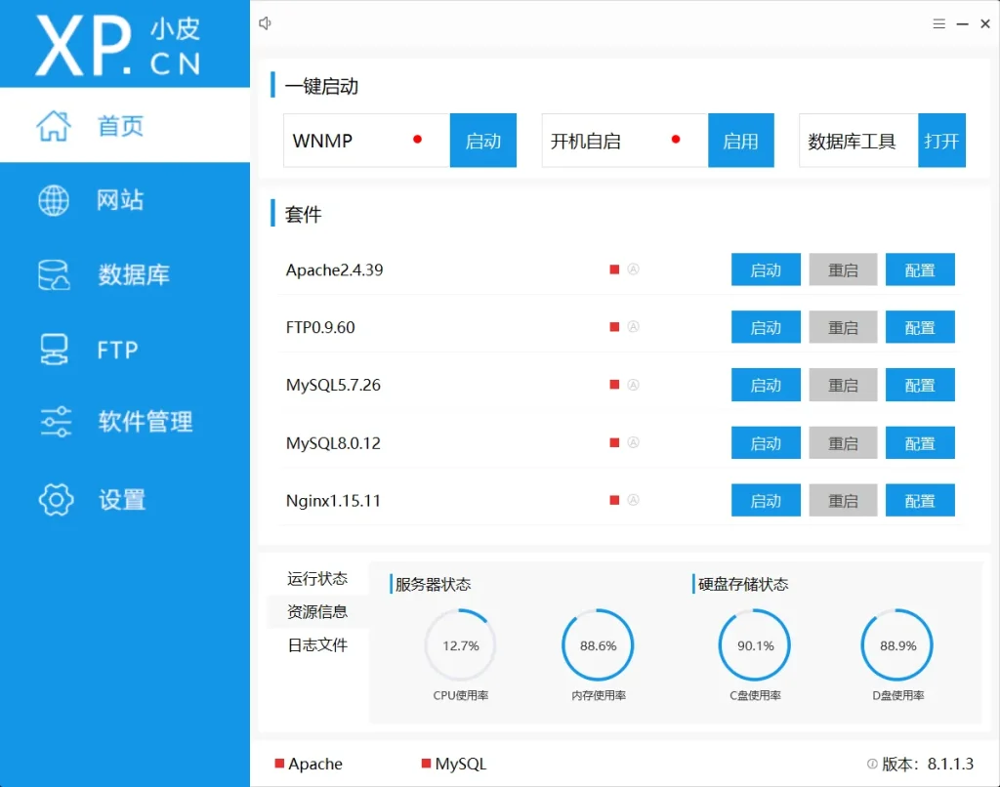

安装好PHPstudy之后点击一键启动

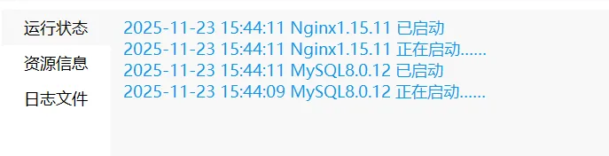

可以看到启动了**Nginx服务器**和**MySQL数据库**

在左侧网站可以看到 `localhost:80`有一个默认网站


只需要把网页文件：`html`或`php`上传到`WWW`，如图

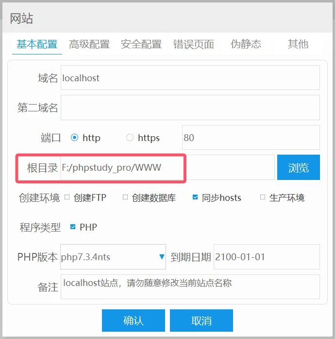

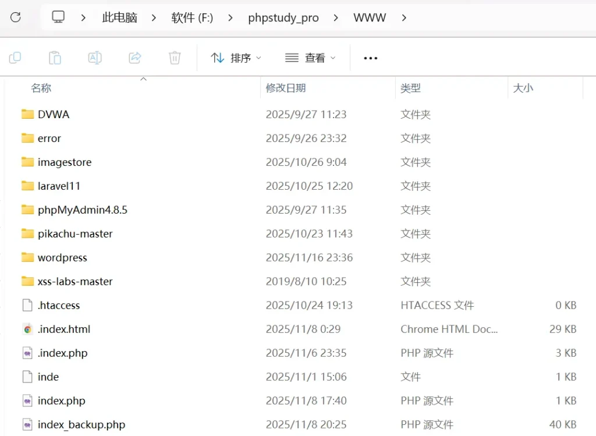

到浏览器访问 `localhost:80` 或 `127.0.0.1:80` 即可看见网页能够正常访问

例如在 `index.html` 内写入语句

```
</h1>
hello,world
<h1>
```

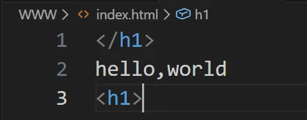

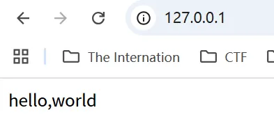

打开网页即可看到打印了 `hello,world`

但目前只能在**局域网访问**，其他人不能打开页面

### 外部浏览本地网页

这时候需要用到**内网穿透技术**

什么是内网穿透？

简要来说内网穿透就是将内网的服务通过**端口映射**到一个**具有公网ip的服务器**上面能够让互联网当中其他用户访问这个服务

可以选择其中一种内网穿透服务商：

- sakurafrp（推荐）（需要实名认证）
- ngrok（推荐）
- natapp
- Cpolar

以 `Sakurafrp` 为例

进入 `Sakurafrp` 官网[https://www.natfrp.com/](https://www.natfrp.com/)


点击 **注册账号**

别忘了实名认证

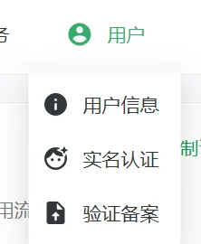

点击实名认证需要使用支付宝支付服务费（不多，就一两块）

---

绑定好信息之后进入 **管理面板-服务**

*tip：可以在首页签到获得流量*


点击 **创建隧道**

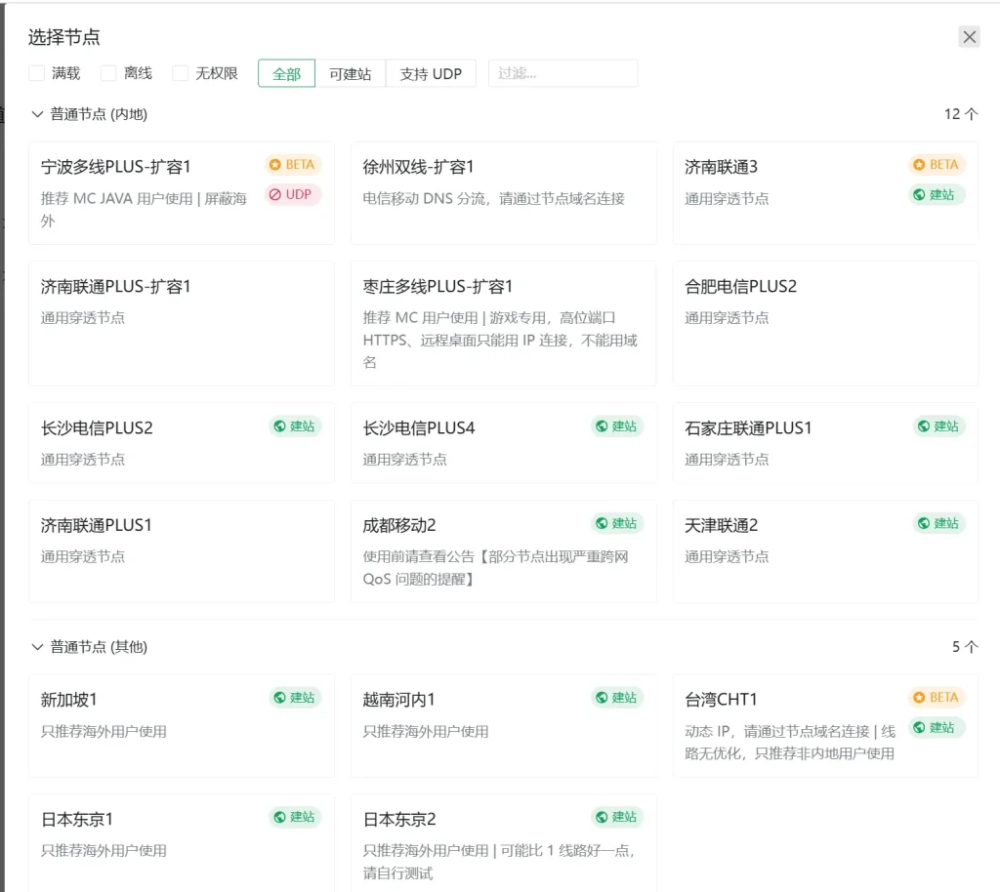

选择一个支持建站的节点

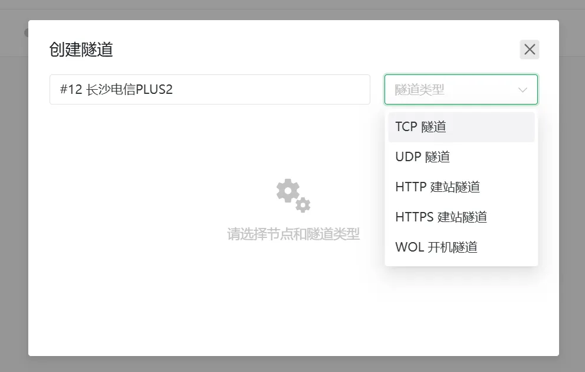

这里会让你选择类型，按照常理来说应该选择 **HTTP/S**但是经过实测 **TCP**也可以打开网页，如果选择 **HTTP/S**国内节点还需要填写备案信息，比较麻烦

我曾经建好的隧道

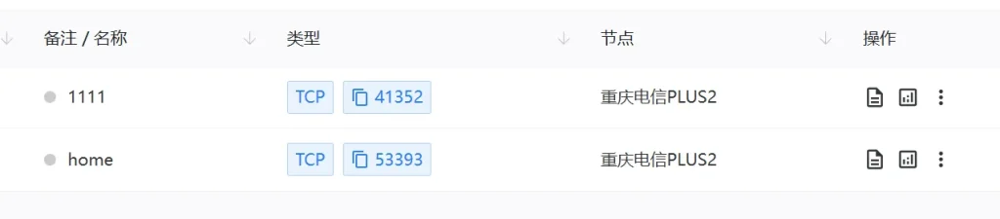

**下载Sakurafrp客户端**

点击 **服务-软件下载**

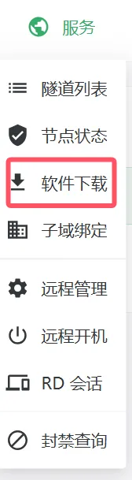

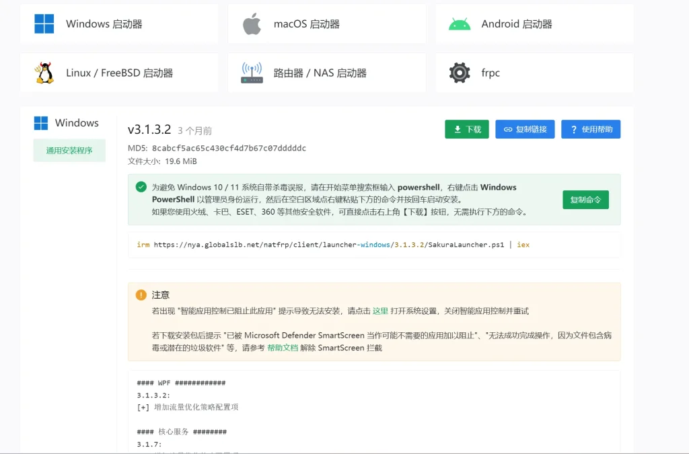

按照自己系统情况选择下载，如果是 **Windows**就点击图中的 **绿色下载标志**

下载好之后打开启动器

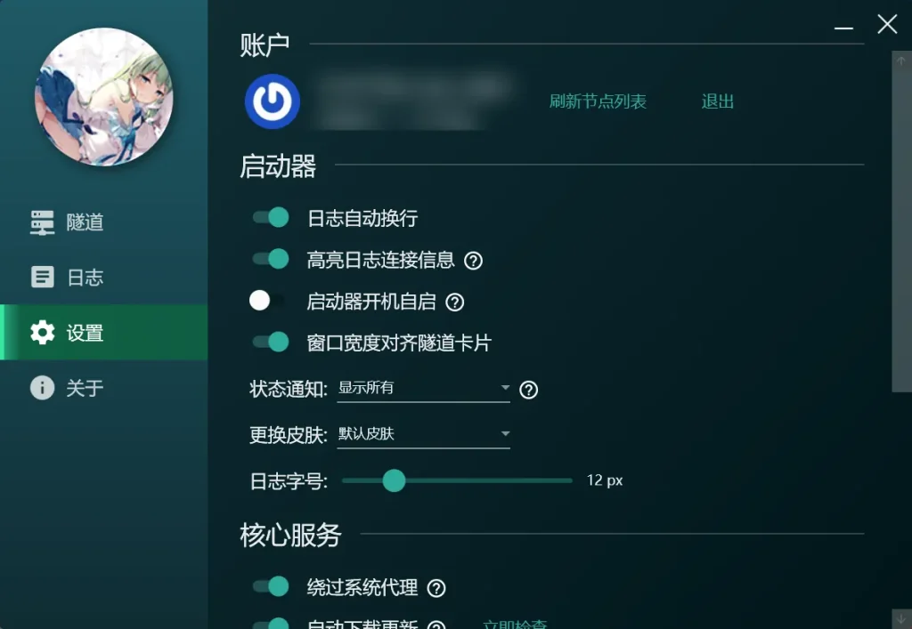

在设置里面 **绑定账户**

再次进入 **官网-用户**

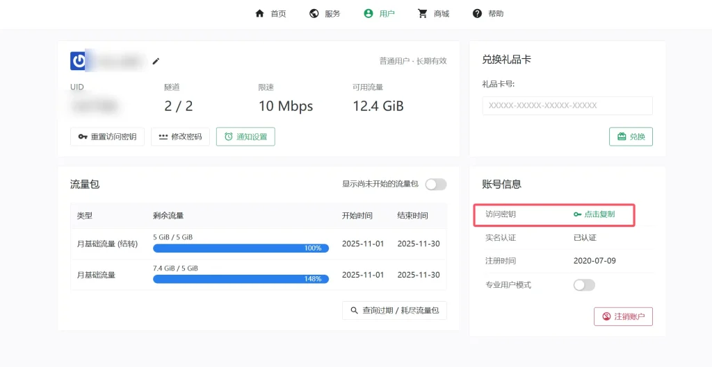

点击 **复制访问密钥**

到启动器中绑定

然后在隧道列表可以看到刚才创建好的隧道

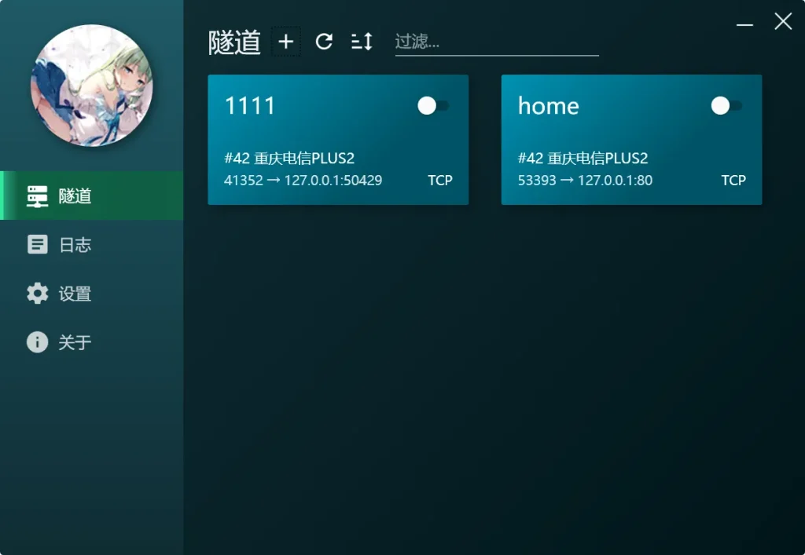

当然也可以直接在启动器当中创建隧道，点击上方的 **+号**按需选择即可

在编辑隧道界面可以看到本地端口，要**绑定80端口**，因为**http服务**运行在80端口

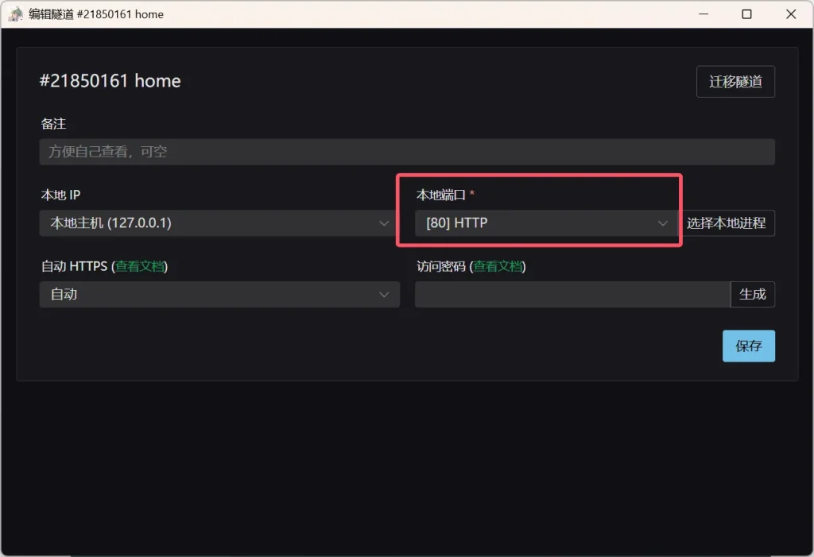

配置好之后点击这个按钮启动

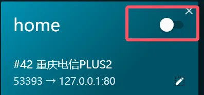

然后转到 **日志**

可以利用以下两种方式访问本机的网页（**IP连接不推荐**）

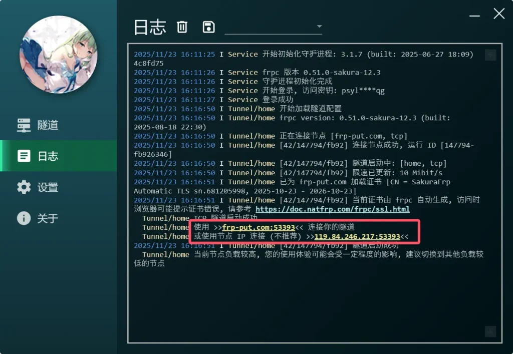


到此，就可以让互联网当中其他人访问自己的网页了

---

学会了**Sakurafrp**的操作再使用其他服务商就不难上手了

例如使用 **ngrok**同理

可以访问[https://humid-briana-unslowly.ngrok-free.dev](https://humid-briana-unslowly.ngrok-free.dev) 打开本机的网页

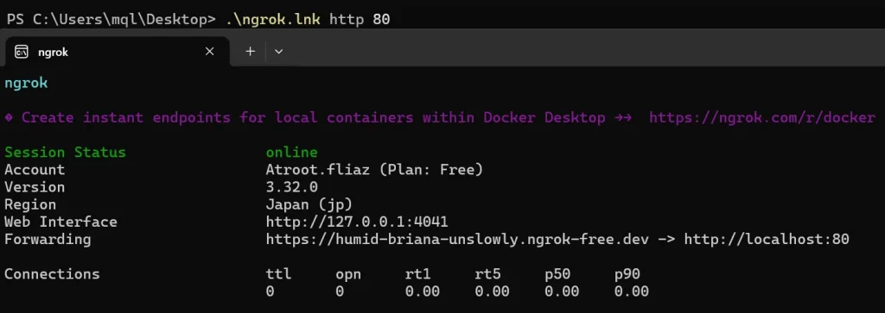

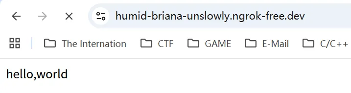

## 云端建站

准备工作：

- 具有公网ip的云服务器
- git（可选）
- 域名

准备一台云服务器，可以在各大云平台**绑定学生认证**领取优惠，购买服务器更划算，甚至可以白嫖数月

*Azure绑定学生认证之后可以白嫖2年1g1h的服务器*

前置知识：关于静态网页和动态网页的区别可以看[https://zhuanlan.zhihu.com/p/215799848](https://zhuanlan.zhihu.com/p/215799848)

### 静态网页

#### 本地存放

**基于hexo框架将本地文件通过git发送到云服务器，让云服务器渲染页面**

操作步骤：

云服务器配置：

开放ssh端口（默认22）

运行nginx服务

运行git服务

本地配置：

操作Linux系统

下载hexo框架

运行git服务

---

以下是一个已经在我电脑本地部署好的网页目录

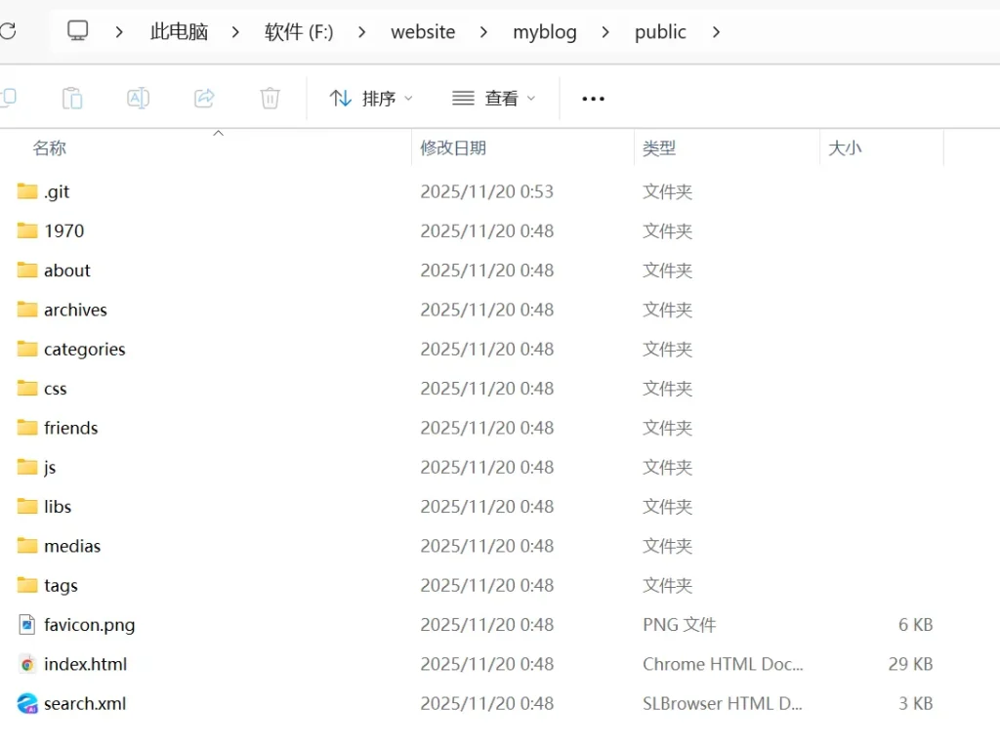

效果图：***matery主题**~~(还没有来得及修改内容)~~*

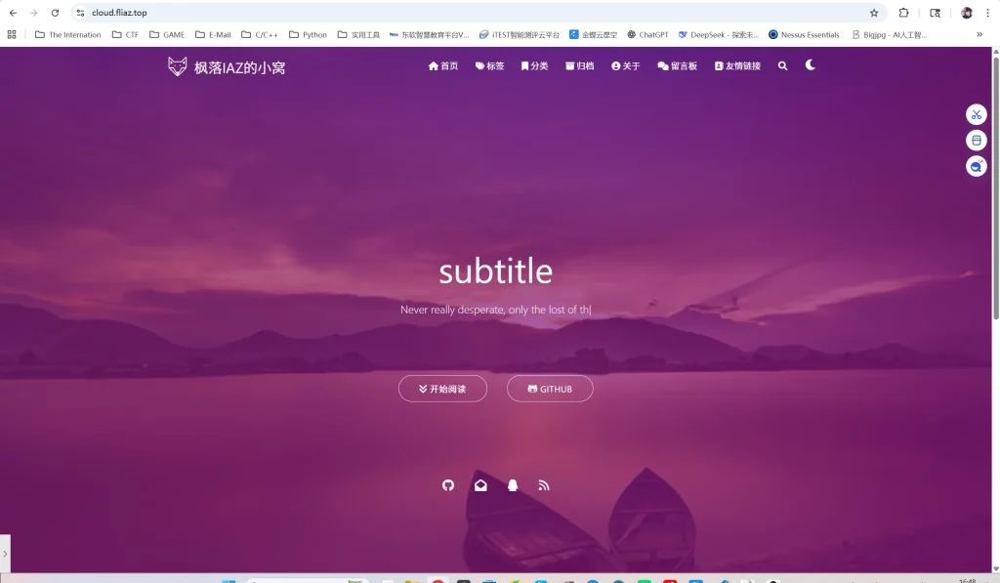

---

打开云服务器控制台，将购买的域名解析到云服务器的ip（大陆服务器需要备案，耗时长）

配置好git，关于git的配置请参考***Git 安装配置 | 菜鸟教程***[***https://www.runoob.com/git/git-install-setup.html***](https://www.runoob.com/git/git-install-setup.html)

同时参考 ***[基于hexo部署本地网页到云端.md]***

#### 云端存放

**基于hexo框架让云服务器渲染页面**

和本地存放的区别就是git那一步，其余步骤大差不差

### 动态网页

使用**WordPress框架**比较方便，但由于是动态网页，插件漏洞很多，安全性低，不利于维护

效果图：***基于Sakurairo主题***


---

操作步骤：

在云服务器下载WordPress

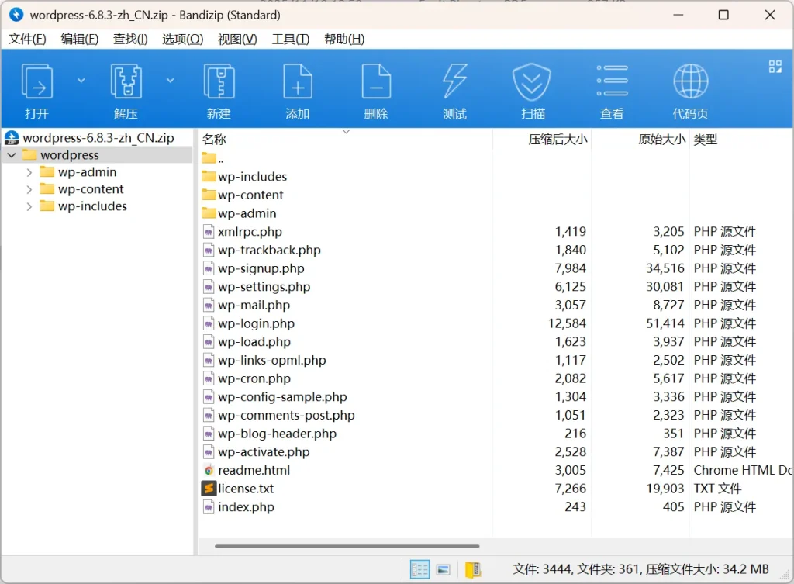

只需要将这些解压到服务端的 **/www目录**下即可

启动nginx服务之后访问**80端口**会自动弹出安装页面，跟着指引安装，配置相关信息

后台管理可以使用别人做好的主题

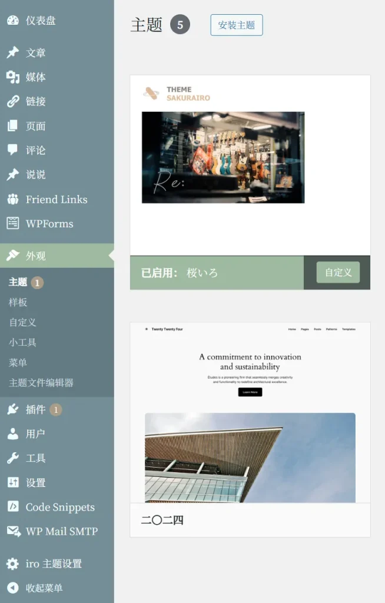

最后在云服务器控制台**解析域名**即可

到此关于建站的基础知识告一段落
